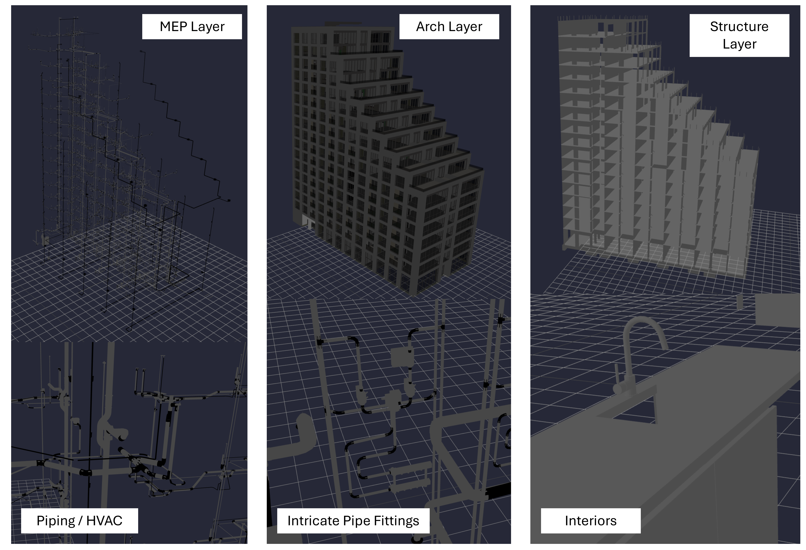
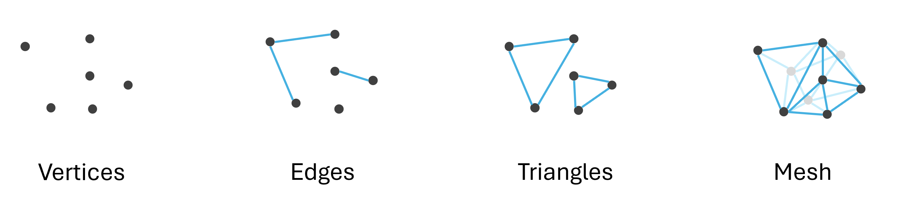

# A Game Developer's Approach to BIM Part I: Draw Calls

> Building Information Modelling (BIM) is a construction-native technology solution that sits at the intersection of data management and 3D modelling. It abets the vast amounts of data produced on a construction site, with a 3D visual user interface. However, widespread adoption is lacking in the North American market, and I believe one of the key hurdles to integration is on the technology front, where efficient open source tools are limited or lacking.

## Introduction

Construction 3D models face unique challenges in the computer graphics space. Anyone brave enough to wrangle them faces a steep learning curve consisting of complex vector math, in-depth computer terminology, and non standardized data formats. This means that even if you do manage to load up a model on one machine, it might not work on another.

Indeed, this is how I started learning this subject matter. Over the past few months, I've been researching BIM modeling through a lens that I relate most with- video games, and while I am certainly no expert in the field, I wanted to share the lessons I have learned in the process. This is part 1 in a 6 part series where we dive into the theory behind the techniques used by video game developers to make a scene run smoothly. Our goal will be to render a large IFC 3D model file to the screen at 60 FPS, without needing high-end hardware. That last part is key, as you will see later on- using an NVIDIA graphics card is like playing on easy mode.

I'd like for *anyone* regardless of their computer specs, to be able to load up this model and enjoy the same smooth experience. And, without spoiling too much- this is indeed what we were able to achieve. Here is the final result. 

Let's dive in to how we got here.

## Exploring the Test Model

The model we shall be working with is of a real high-rise residential building in the Netherlands called [Sixty5](https://www.strijp-s.nl/en/building/sixty5), courtesy of the [buildingsmart-community](https://github.com/buildingsmart-community). This IFC file consists of 78,359 objects spread across 6 layers.

Here are some screenshots showing what the model looks like.

And here is a breakdown of the data.

| Model Layer | No. Objects | No. Triangles | File Size (MB) |
| ----------- | ----------- | --------------------- | ----------- |
| Architectural | 19,980 | 1,639,524 | 334.5 MB |
| Electrical | 20,140 | 12,132,070 | 94.8 MB |
| HVAC | 11,991 | 15,096,829 | 112.2 MB |
| Interiors | 3,099 | 1,608,938 | 48.5 MB |
| Mechanical (MEP) | 22,544 | 8,458,171 | 216.9 MB |
| Structural | 605 | 55,059 | 7.2 MB |
| **Total** | **78,359** | **38,990,591** | **814.1 MB** |

I began my journey rather naively with a simple idea. At is most fundamental, a 3D object consists of points connected by lines (known as `vertices` and `edges`). 3 `edges` combine in a loop to form a `triangle`, and a `triangle` is ultimately the smallest building block of a `mesh`.

The less triangles there are on the screen, the better the performance. So, why don't we simply swap out our mesh for one that is of a lower resolution until the user zooms in? This process actually has a name- Level of Detail (LOD) Modelling. Here, we save multiple versions of our 3D object to memory and dynamically change which one is active at any time.

This actually works great! We drastically reduced the number of triangles active at any time, and our scene runs smoothly. This was the discussion piece behind our Proof of Concept earlier. Let's scale this up.

[In prior work](per-object-lod-control-with-threejs.md), we were able to establish that dynamic switching between low and high resolution meshes improves performance of a 3D scene. In that example, the piperack mesh in the scene rendered in low resolution (less triangles) initially (shown in red), and only swapped to full high definition (shown in green) when the user zoomed in past a point.

We determined that this technique- called Level of Detail (LOD) modelling- improved performance of the scene on average by ~3x, while keeping `draw calls` constant. However, we did not elaborate more on that statement. What is a `Draw Call`?

## A Game Developer's Approach to BIM Part II: Instancing

## A Game Developer's Approach to BIM Part III: LOD Control

## A Game Developer's Approach to BIM Part IV: Spatial Querying

## A Game Developer's Approach to BIM Part V: The Render Loop

## A Game Developer's Approach to BIM Part VI: Memory